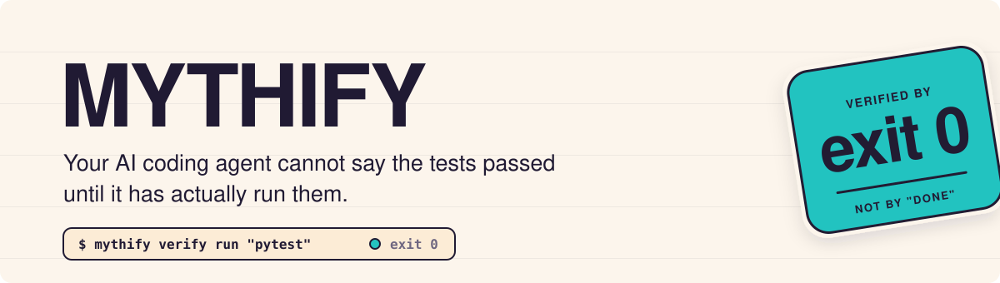
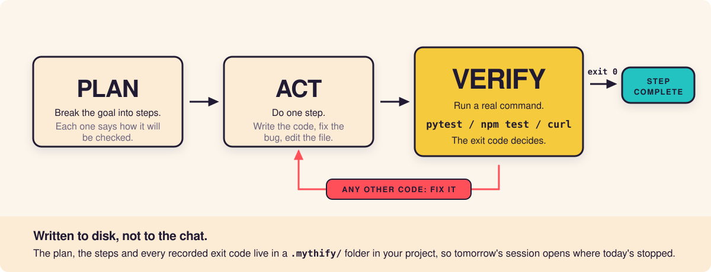

<p align="center">
  
</p>

<p align="center">
  <a href="https://github.com/hannsxpeter/mythify/actions/workflows/ci.yml"></a>
  <a href="https://github.com/hannsxpeter/mythify/releases/latest"></a>
  
  
  
  <a href="LICENSE"></a>
</p>

## Your AI just said "done." Did it check?

Ask an AI coding assistant to fix a bug and you will usually get a confident
reply: *"Fixed. All tests pass."* Often no test was run. The agent read the
code, decided the change looked right, and told you what it believed. From the
message alone, you cannot tell whether that belief was correct.

**Mythify closes that gap.** Before any piece of work can be marked finished,
the agent has to run a real command and record what came back. It passed, or it
did not. Nobody's opinion is involved.

Mythify enforces evidence. It does not claim to make the model smarter.

<p align="center">
  
</p>

## How it works

You write down the goal as a plan, and each step names the command that proves
it is done. The agent does the work. Mythify runs that command, records the
exit code, the output, and the git state, and only then lets the step close.
When the check fails, the step stays open until the cause is fixed and the
check passes. Larger decisions, retry loops, and reviews follow the same rule:
a recorded command beats a stated belief.

## What changes for you

- A step cannot be marked complete with only a sentence. Mythify refuses, and
  that refusal is the product.
- Every check, exit code, and reversal is written to plain files in
  `.mythify/`, so you can read what was actually verified without reading code.
- The plan, decisions, and evidence live in your project, so tomorrow's session
  opens where today's stopped.

## Who it is for

- **You use an AI coding assistant** and have been burned by a "done" that was
  not done.
- **You ship software without being an engineer yourself** and want a second
  opinion that is an exit code, not an opinion.
- **You lead a team that builds with AI** and want a written trail of what was
  attempted, what was checked, and what is still unproven.
- **You run long or multi-session work** and need it to survive a closed chat.

## What you get

- **Completion you can trust.** A step finishes only after its own check
  exits 0.
- **A record anyone can read.** Plain JSON and JSONL files, no service.
- **Fast verification.** Reuse an identical passing run, name your project's
  checks, and block hooks on work with no current evidence.
- **Reviews that end.** Findings reviews stop after three rounds, and a change
  to auth, payments, migrations, or deploy files is flagged until it has a
  review and the person's own words.
- **Autonomy with a fence.** Give the agent a finish line, a budget, and
  allowed paths. It stops at the first one it hits.
- **Memory that survives the session.** Facts, decisions, and lessons stay on
  disk for the next session to read.

## Quickstart

Mythify needs Python 3.9 or newer and nothing else.

```bash
git clone https://github.com/hannsxpeter/mythify.git
cd mythify
./scripts/install_user.sh --project /path/to/your/project
```

The installer puts `mythify`, `mythify-mcp`, and `mythify-uninstall` in
`~/.local/bin` and runs `mythify init` in your project. Copy `AGENTS.md` from
the clone into your project root so your agent reads the protocol. Then, inside
your project:

```bash
mythify plan create "Fix the failing parser test" \
  --steps '[{"title":"Reproduce and fix","success_criteria":"parser tests pass","verify_command":"python3 -m unittest discover -s tests"}]'

mythify step 1 in_progress
# ... you, or your agent, do the work ...
mythify plan verify 1               # Mythify runs the step's own check
mythify step 1 completed "verify run exit 0: parser tests pass"
```

The last line succeeds only because a real check passed first. Try it before
`plan verify` and Mythify refuses with exit 1:

```text
[FAIL] Verified evidence required: strict evidence mode is enabled by default,
but no passing executed 'verify run' with exit code 0 was recorded since this
step started. ...
```

To see where you are, run `mythify status` (the active plan, the next step,
and what needs attention), `mythify report` (a plain-language play-by-play of
recent progress), or `mythify summary` (the whole session: plans, evidence,
lessons).

No install? Run `python3 /path/to/mythify/scripts/mythify.py ...` from your
project directory wherever this page says `mythify ...`.

## Works with any model and any host

Mythify never names, ranks, picks, or switches a model, and it never starts a
helper on its own. It runs as a command-line tool, and `mythify-mcp` serves the
same commands as MCP tools for hosts that call tools instead of a shell. The
protocol file names no model, so the same file applies to whatever your host
runs.

## Learn more

- [docs/start-here.md](docs/start-here.md): the shortest path to a working loop.
- [docs/guide.md](docs/guide.md): plans, verification, maps, outcome loops, reviews, memory, and routing.
- [docs/commands.md](docs/commands.md): every command and flag.
- [docs/mcp.md](docs/mcp.md): MCP setup for any host.
- [docs/campaigns.md](docs/campaigns.md): continue a plan across sessions.
- [docs/blast-radius.md](docs/blast-radius.md): safety cases for changes whose risk sits outside the diff.
- [docs/reviews.md](docs/reviews.md): findings reviews and the high-risk path check.
- [docs/checks-and-gate.md](docs/checks-and-gate.md): named checks and the verify gate for host hooks.
- [docs/prose-quality.md](docs/prose-quality.md): the prose rewrite pass and the mechanical prose check.
- [docs/architecture.md](docs/architecture.md): state model, runtime, decisions.
- [CONTRIBUTING.md](CONTRIBUTING.md) and [CHANGELOG.md](CHANGELOG.md).

## License

MIT. See [LICENSE](LICENSE).
